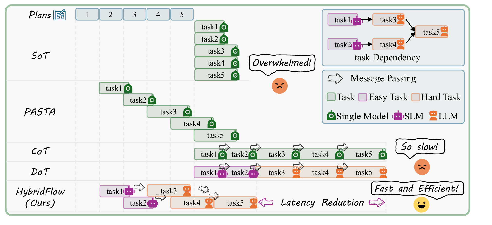
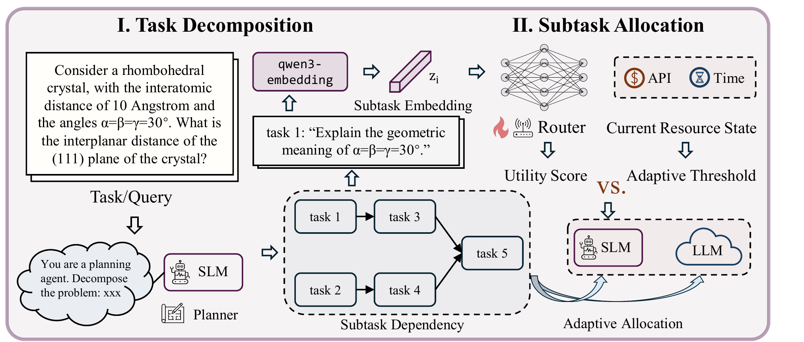
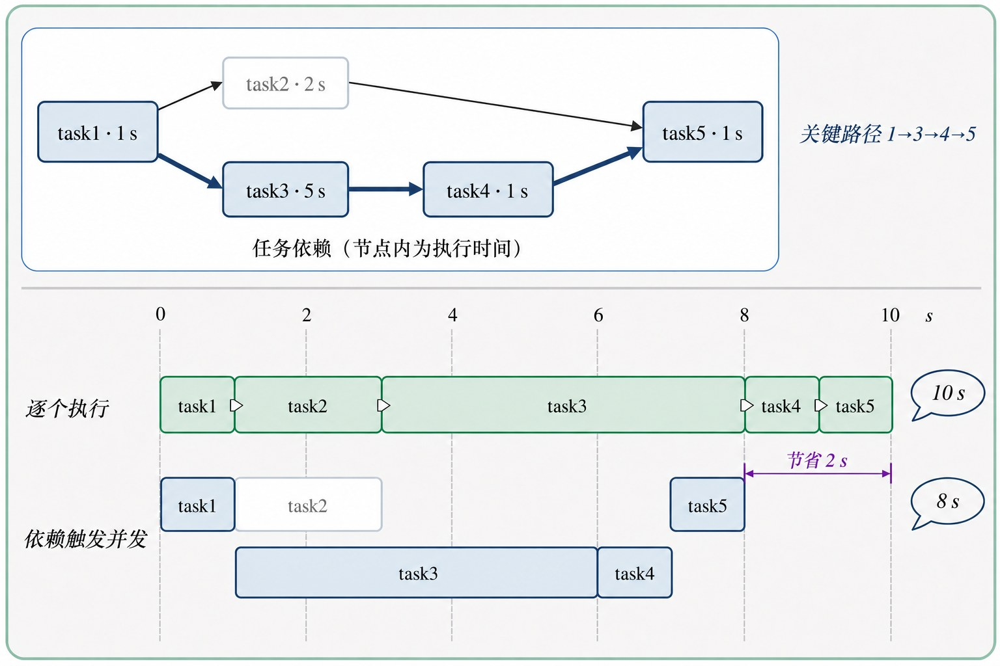
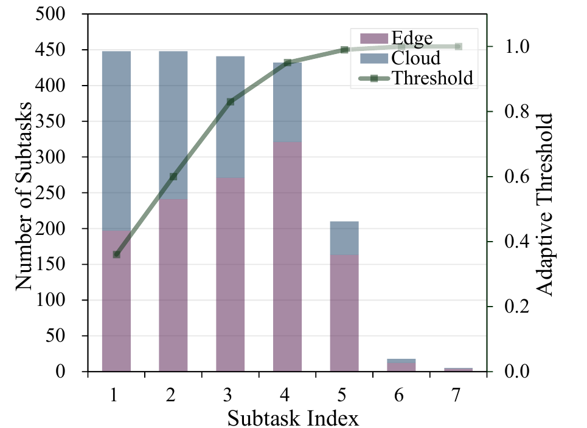
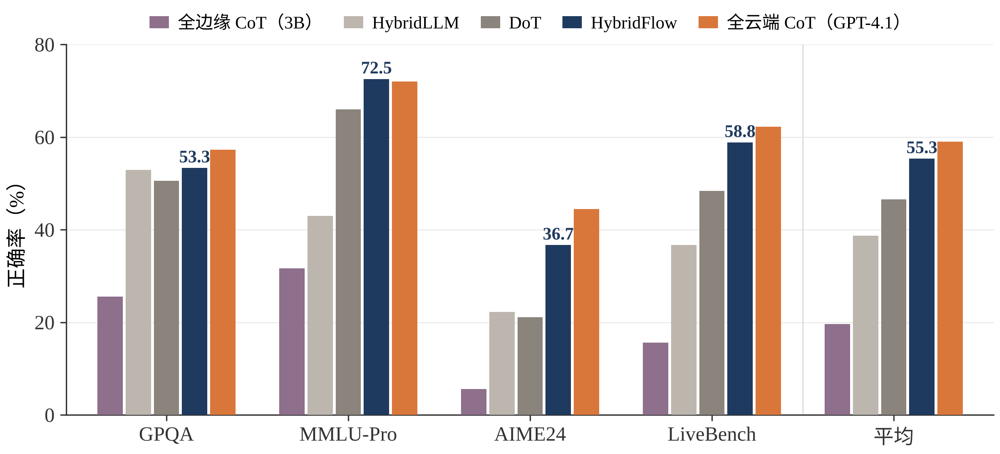
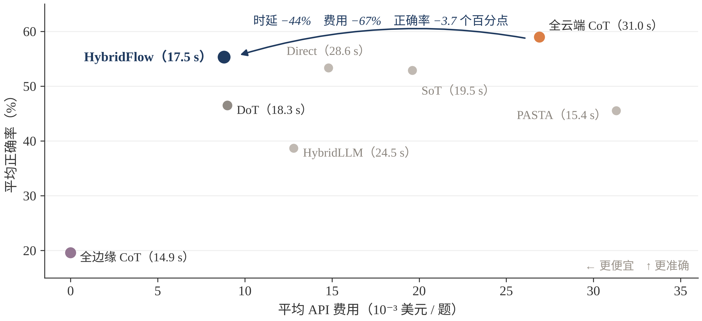
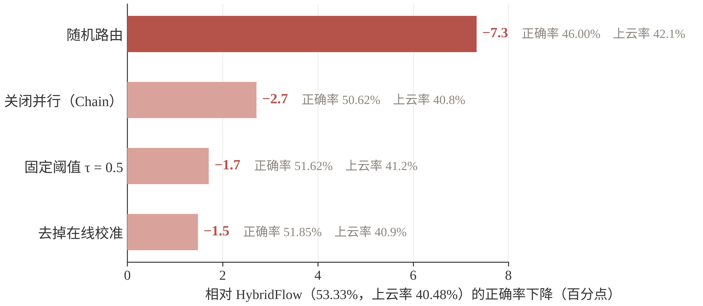

# HybridFlow: Resource-Adaptive Subtask Routing for Efficient Edge-Cloud LLM Inference

| 项目 | 内容 |
|---|---|
| 作者 | Jiangwen Dong, Jiayu Li, Tianhang Zheng, Wanyu Lin（香港理工大学、浙江大学） |
| 发表 | ICML 2026 |
| 链接 | [论文](https://arxiv.org/abs/2512.22137) · [代码](https://github.com/WanyuGroup/ICML2026_HybridFlow) |
| 关键词 | 边云协同推理、任务分解、DAG 调度、子任务路由、0-1 背包、拉格朗日松弛 |
| 阅读日期 | 2026-10-24 |

> **一句话总结**：把一个查询拆成带依赖的子任务 DAG，互不依赖的子任务并行执行；每个子任务用 MLP 预测“上云的性价比”，与一个随资源消耗不断上涨的阈值比较，高于阈值才交给云端大模型，否则留在边缘小模型上执行。在四个推理基准上，正确率接近全云端，时延和费用大幅下降。

## 1. 问题与动机

- **场景**：边缘设备上部署小模型，云端通过 API 调用大模型，二者协同回答推理类问题。
- **痛点**：全边缘（Llama3.2-3B）平均正确率只有 19.59%；全云端（GPT-4.1）有 58.99%，但平均时延 31.02 s、每题约 0.027 美元（论文表 1、表 2）。
- **已有方法的不足**：

| 已有方法 | 怎么做的 | 不足 |
|---|---|---|
| CoT | 一步接一步推理 | 串行，慢 |
| SoT / PASTA | 先列骨架，再并行展开 | 对子任务之间的依赖处理得很弱 |
| Hybrid LLM | 整题路由给小模型或大模型 | 同一题里各步骤难度不同，整题路由太粗 |
| DoT | 分解成依赖图，分层并行，子任务按难度分给边或云 | 不考虑代价，也没有预算约束 |

- **本文要回答的问题**：怎么分解、哪些可以并行、每个子任务交给谁，并且在有限的时延和费用预算内完成。


*图源：论文图 2。注意：图中把 DoT 画成了串行，DoT 原文实为按依赖深度分层并行*

## 2. 核心思路

先由边缘规划器把查询分解成 DAG，按依赖并发执行；每个子任务就绪时，用 MLP 预测它上云的性价比，与一个随资源消耗上涨的阈值比较，决定在边缘还是云端执行。这条决策规则来自对 0-1 背包问题的拉格朗日松弛：性价比高于“资源价格”就上云。


*图源：论文图 1。左半为任务分解，右半为子任务分配*

## 3. 方法细节

### 3.1 规划：EAG 模板 + 校验修复

边缘规划器（Llama3.2-3B）按 Explain–Analyze–Generate 模板输出带依赖的 XML 计划：Explain 是唯一根节点，提炼题意；Analyze 是若干中间子任务，尽量互不依赖；Generate 是唯一汇点，汇总得出答案。

计划解析成 DAG 后按 6 条规则校验：无环、单一根、全部可达、唯一汇点、子任务数不超过 7、依赖一致。不合法时最多修复 2 轮，仍失败就退化为一条链。

附录数据：约 76%–78% 的计划直接合法，13%–14% 修复后合法，约 10% 退化为链；退化为链的题目正确率 52.8%，合法计划的是 53.5%，主要代价是时延多约 1.4 s。规划本身平均耗时 2.14 s。

### 3.2 调度：依赖触发的并发执行

相当于 Kahn 拓扑排序的并发版：维护每个子任务的入度，入度为 0 就立即派发到边或云，完成后把后继的入度减 1。与 DoT 的分层并行不同，这里不用等同层最慢的子任务。端到端时延由关键路径决定：

$$
T_{\text{DAG}} = \max_{\pi \in \text{paths}(G)} \sum_{i \in \pi} d_i \;\le\; T_{\text{chain}} = \sum_i d_i
$$


*自绘示意图，数值为示意*

论文用压缩率 $R_{\text{comp}} = (n - L_{\text{crit}})/n$ 衡量计划的并行潜力，$L_{\text{crit}}$ 为关键路径上的子任务数。

### 3.3 关键公式与推导

**收益与代价。** 对每个子任务 $i$：

$$
\Delta q_i = \mathbb{E}_{\mathbf r_{-i}}\big[\text{Score}(r_i = 1, \mathbf r_{-i}) - \text{Score}(r_i = 0, \mathbf r_{-i})\big],
\qquad
c_i = \tfrac12\left(\frac{\Delta l_i}{10\ \text{s}} + \frac{\Delta k_i}{\$0.02}\right)
$$

收益是“只把子任务 $i$ 换到云端时，最终答案得分的平均变化”；代价是额外时延与额外费用各自归一化后取平均。效用定义为性价比 $u_i = \text{clip}\big(\Delta q_i/(c_i+\varepsilon), 0, 1\big)$。离线估计 $\Delta q_i$ 时，每个子任务在边、云各跑一次并缓存，再随机组合路由求平均（2,000 条查询、12,400 个子任务，约 8.8 h、1.36 美元）。

**从 0-1 背包到阈值规则。** 在预算内选哪些子任务上云：

$$
\max_{\mathbf r \in \{0,1\}^n} \sum_i r_i \Delta q_i \quad \text{s.t.} \quad \sum_i r_i c_i \le C_{\max}
$$

引入价格 $\lambda \ge 0$，把预算约束移进目标并整理：

$$
\mathcal L(\mathbf r, \lambda) = \lambda C_{\max} + \sum_i r_i(\Delta q_i - \lambda c_i)
\quad\Longrightarrow\quad
r_i^\star(\lambda) = \mathbb 1\left[\frac{\Delta q_i}{c_i} > \lambda\right]
$$

每一项只含一个 $r_i$，所以子任务可以各自决策：性价比高于价格就上云。

**价格更新。** 对偶函数 $g(\lambda) = \max_{\mathbf r}\mathcal L$ 对任意 $\lambda\ge0$ 都是最优收益的上界；它的次梯度是“预算 − 当前价格下选中的总代价”。沿负次梯度更新再在线化，得到正文式 (10)、(11)：

$$
\lambda_{t+1} = \big[\lambda_t + \eta\,(C_{\text{used}}(t) - C_{\max})\big]_+,
\qquad
\tau_t = \text{clip}(\tau_0 + \gamma\lambda_t, 0, 1)
$$

**实验中实际使用的阈值**是附录式 (27)，随已用费用和时延线性上涨、只升不降：

$$
\tau_t = \text{clip}\left(\tau_0 + \frac{k_{\text{used}}}{2K_{\max}} + \frac{l_{\text{used}}}{2L_{\max}},\ 0,\ 1\right),
\quad \tau_0 = 0.2,\ K_{\max} = \$0.02,\ L_{\max} = 20\ \text{s}
$$


*图源：论文图 3（GPQA）。阈值从约 0.36 升到接近 1，云端调用集中在前几步*

### 3.4 效用预测器与在线校准

推理时不知道 $\Delta q_i$ 和 $c_i$，用 MLP 直接预测性价比：子任务文本经 qwen3-embedding-0.6b 编码，与已用预算一起输入，$\hat u_i = \sigma\big(f_\theta(z_i, C_{\text{used}}(t))\big)$，用 MSE 回归 $u_i$。路由规则为 $\hat u_i > \tau_t$ 则上云。

可选的在线校准：在 MLP 输出后接线性修正 $\tilde u_i = \text{clip}(\alpha\hat u_i + \beta + \mathbf w^\top \mathbf s_i, 0, 1)$。只有上云才能观察到收益，属于上下文赌博机问题，用 LinUCB 一类方法更新参数，奖励为 $R_i = \Delta q_i - \lambda_t c_i$。

## 4. 实验

- **设置**：边缘 Llama3.2-3B（规划器兼执行器，单张 RTX 3090），云端 GPT-4.1；基准为 GPQA、MMLU-Pro、AIME24、LiveBench-Reasoning；指标为正确率、端到端时延、API 费用。
- **主要结果**（四个基准平均，论文表 1、表 2）：

| 方法 | 正确率 | 时延 | 费用（美元/题） |
|---|---|---|---|
| 全边缘 CoT | 19.59% | 14.9 s | 0 |
| 全云端 CoT | 58.99% | 31.02 s | 0.0269 |
| Hybrid LLM | 38.70% | 24.45 s | 0.0128 |
| DoT | 46.50% | 18.32 s | 0.0090 |
| **HybridFlow** | **55.34%** | **17.48 s** | **0.0088** |


*根据论文表 1 绘制*


*根据论文表 1、表 2 绘制，括号内为平均时延*

- **消融 / 敏感性**（GPQA，各变体上云率均为 40%–42%）：随机路由 −7.3 个百分点，关闭并行 −2.7，固定阈值 0.5 −1.7，去掉校准 −1.5。作者 rebuttal 补充：去掉校准后 AIME24 从 36.67% 降到 20.00%；时延归一化常数从 10 s 改为 5 s，GPQA 正确率从 53.33% 降到 35.04%。


*根据论文表 3 绘制*

- **泛化**：换成 Qwen2.5-7B（边）+ DeepSeek-V3（云），只测 GPQA：HybridFlow 53%，DoT 49%，Hybrid LLM 47%，全云端 59%。
- **附录：规划器 SFT**（执行器全为 3B）：并行潜力 10.7% → 34.3%，正确率 20% → 22%，时延 10.81 s → 11.59 s。
- **我认为最有说服力的结果**：消融里随机路由在相同上云率下掉 7.3 个百分点，说明“花在哪些子任务上”确实比“花多少”重要。
- **我认为最弱的结果**：相对 DoT 的效率优势很小（时延 −4.6%，费用 −2.2%），MMLU-Pro 上时延甚至比 DoT 慢；泛化实验只测了一个基准。

## 5. 我的理解与疑问

1. **理论推导与实际实现之间有缝隙。** 正文用原始–对偶推导价格更新，实验却用式 (27) 线性涨价、只升不降。即使收益和代价都已知、价格取到最优，阈值规则选出的也只是性价比贪心解，最坏情况下没有常数近似比（Vazirani《Approximation Algorithms》习题 8.1；补一步“与临界物品单独比较”才有 2 倍近似，习题 8.2）。全文没有近似比或竞争比，有效性完全靠实验。
2. **代价没有考虑关键路径。** 不在关键路径上的子任务有松弛时间，上云多花的时间可能被完全吸收，但仍按全额计入代价，导致一些“几乎不增加时延”的上云机会被错过。
3. **收益可加的假设，以及缓存重组。** 背包假设总收益可按子任务相加，但上游答错时下游上云也无用。缓存只按“子任务 × 模型”存一份，可子任务的输出还取决于上游实际传来的结果：t₁ 查单价（边缘查错为 14 元、云端查对为 15 元），t₂ 按单价计算；重组时把 t₁ 换到云端，t₂ 仍用缓存里基于 14 元的结果，最终仍错，t₁ 的贡献被估计为 0。这只影响训练标签，不影响在线测得的主实验结果。
4. **规划为什么放在边缘？** 论文理由是规划在每条查询的关键路径上，放云端每题都多一次往返和费用；原问题也不出设备。但没有做云端规划的对照实验。
5. **论文与代码是否一致**（按 2026 年 10 月的公开仓库核对）：
   - 路由按 $\sigma((s-\delta)/0.1)$ 的概率随机决定，不是确定性阈值；
   - 第一步和最后一步强制上云；
   - 质量标签用“云端输出 token 数 − 边缘输出 token 数”近似，而非最终答案得分；
   - 训练目标是 Huber 损失回归“收益减代价”并加预算惩罚，而非 MSE 回归性价比；
   - 训练时的元特征包含标签本身，推理时大部分特征填 0；
   - 仓库中找不到在线校准模块和生成 profiling 数据的脚本；
   - 并行度指标写成 max_depth/n，方向与论文相反。

## 6. 与相关工作的关系

| 工作 | 关系 |
|---|---|
| Division-of-Thoughts（WWW 2025） | 前身：分解 + 依赖图 + 子任务边云分配；按难度分配，无预算 |
| Hybrid LLM（ICLR 2024） | 对比：整题路由，学习“小模型是否不比大模型差” |
| Skeleton-of-Thought（ICLR 2024）、LLMCompiler（ICML 2024） | 对比：并行执行与依赖规划，只用单一模型 |
| Minions（ICML 2025） | 对比：反过来，云端分解、本地并行执行 |
| Adaptive LLM Routing under Budget Constraints（EMNLP 2025） | 互补：赌博机 + 背包的预算路由 |
| Murakkab（OSDI 2026） | 互补：云端集群级的工作流编排，MILP 离线优化 |
| AIMS（EuroSys 2026） | 后续方向：路由粒度推进到智能体的每一轮迭代 |

**一句话定位**：在 DoT 的“分解 + 并行 + 边云分配”框架上，把 Hybrid LLM 式的学习路由器改成预测性价比，再加上随预算消耗收紧的动态阈值。

## 7. 可以继续想的方向

- **关键路径感知的路由**：按松弛时间折算时延代价，同时决定执行位置和执行顺序；难点是松弛时间要预测，且会随其他决策变化。
- **多查询、多设备的长期资源分配**：考虑边缘排队、并发和网络波动；式 (10) 与 Lyapunov 优化的虚拟队列形式一致，可推广为跨查询的长期预算控制。
- **有理论保证的在线阈值**：借鉴在线背包随已用预算指数上涨的阈值（竞争比 $\ln(U/L)+1$），但要处理“子任务少而大”和“效用是预测值”。
- **规划位置与隐私**：默认本地规划，校验失败或多次采样不一致时再把脱敏后的问题交给云端；隐私敏感的子任务强制留在本地。
- **从单个请求到边缘智能体**：真实智能体还要考虑多轮上下文、KV cache、工具调用和持久状态，路由对象从“子任务”变成“智能体的每一步”。

## 8. 术语速查

- **关键路径**：DAG 中耗时最长的依赖链，决定并发执行后的总时延。
- **拉格朗日松弛**：把约束乘以价格移进目标函数，让耦合的决策可以拆开求解。
- **弱对偶**：任意非负价格下，对偶函数值都不小于原问题最优值。
- **竞争比**：在线算法在最坏情况下与“事后全知”最优解的差距倍数。
- **上下文赌博机 / LinUCB**：只能观察所选动作的反馈，用“估计值 + 不确定性加分”在利用与探索之间权衡。
- **虚拟队列 / Lyapunov 优化**：用累计超支计数器把长期平均约束转化为“队列稳定”，每步最小化“漂移加惩罚”。

## 9. 引用

```bibtex
@inproceedings{dong2026hybridflow,
  title     = {HybridFlow: Resource-Adaptive Subtask Routing for Efficient Edge-Cloud LLM Inference},
  author    = {Dong, Jiangwen and Li, Jiayu and Zheng, Tianhang and Lin, Wanyu},
  booktitle = {International Conference on Machine Learning (ICML)},
  year      = {2026}
}
```
